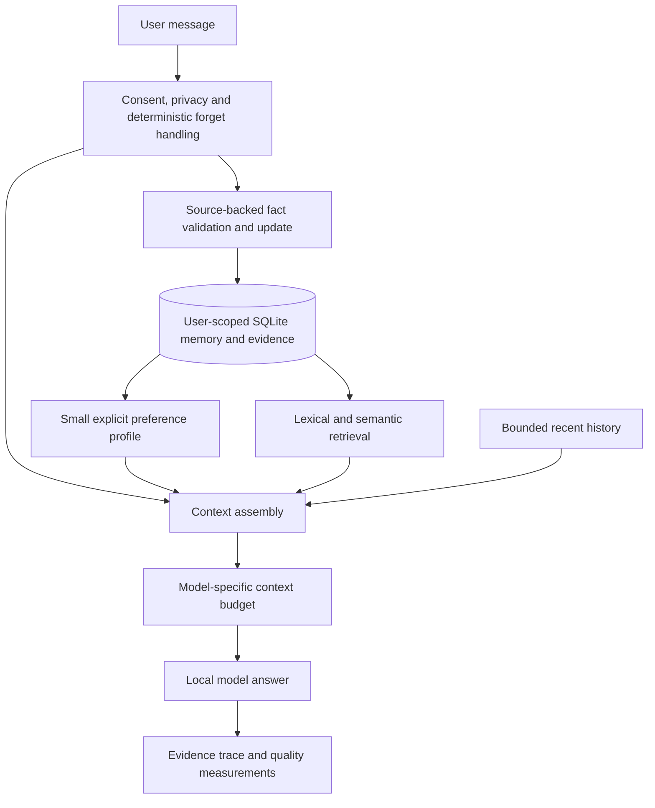

**Agent improvement research — 9 November 2026**

Recommendation: keep LangGraph, Ollama, and SQLite for the next experiment. Establish real-model quality, then test essential-preference recall, hybrid retrieval, and source-backed extraction. Larger memory engines are useful comparative baselines; replacing storage is not yet supported by measurements in this repository.

This is a research overview and a set of proposed experiments, not an implementation plan or a claim of improved performance. Sources are author papers, official repositories, and official documentation inspected on this date. Public repositories demonstrate available approaches, not worldwide deployment shares. Existing notes in [MEMORY_RESEARCH.md](MEMORY_RESEARCH.md) are preserved.

**What the current code does**

The [workflow](../src/personal_assistant/agent.py) uses explicit stages: write memory, retrieve memory, answer, save history. Automatic extraction is opt-in and limited to the latest user message. [Extraction](../src/personal_assistant/extraction.py) requires a supporting quote, but the workflow drops that quote before storage. [Memory search](../src/personal_assistant/memory.py) scans the selected user's vectors and ranks only cosine similarity. Defaults are top four memories and a 0.25 threshold. [Storage](../src/personal_assistant/store.py) overwrites matching canonical keys, deduplicates exact normalized content, and clears the user's histories after corrections or deletion.

These are useful lifecycle controls. The gaps below are code observations, not measured model failures:

| Gap | Example or consequence | Existing component involved |
|---|---|---|
| Essential preferences depend on question similarity | A decorators question can miss the saved response-language preference. | `MemoryService.search`, `Assistant._respond` |
| Extraction sees no previous turn | “Actually, make that Java” lacks the referent needed to update the right fact. | `extract`, `Assistant._write_memory` |
| Supporting evidence is discarded | Later, there may be no surviving message explaining why a fact was saved. | `Candidate`, `Memory`, workflow, SQLite schema |
| Exact keys control conflicts | Different keys can represent contradictory versions of one preference. | Extraction prompt and `MemoryStore.upsert` |
| Storage dates are not event dates | “I moved last March” cannot be represented by `updated_at` alone. | Models and store |
| Context is bounded by counts/characters | There is no explicit input-token budget or query-dependent evidence allocation. | Settings, history, response construction |
| Real model quality is not established | Fake embeddings/extraction test mechanics, not Vietnamese recall or factual accuracy. | [Recorded evaluation](EVALUATION.md), live test |

**Approaches visible in current GitHub projects**

The following are source observations. The “lesson” column is our assessment of their relevance, not a comparative benchmark.

| Project | Observed approach | Lesson and adoption cost for this repo |
|---|---|---|
| [Mem0, inspected snapshot](https://github.com/mem0ai/mem0/blob/f1791daa86d469249c9b002f62644d58a1eb96a0/README.md) | Its April 2026 algorithm description uses additive extraction and semantic, BM25, and entity retrieval. Headline scores explicitly refer to its managed platform and proprietary optimizations. | Try keyword-plus-vector retrieval. Do not assume an SDK upgrade preserves our overwrite semantics or reproduces managed scores. [OSS configuration](https://github.com/mem0ai/mem0/blob/f1791daa86d469249c9b002f62644d58a1eb96a0/docs/open-source/configuration.mdx) documents configurable providers and a separate vector backend. |
| [Letta Code, inspected snapshot](https://github.com/letta-ai/letta-code/blob/7f7300a2c8d4d8aef150d9ea9d01f0edd4f9d710/README.md) | Stateful agent harness with memory blocks, conversation search, git-backed MemFS, and optional background reflection. | Borrow a compact, inspectable user profile. Adopting the whole harness changes orchestration and state ownership. Revision history also requires a deliberate deletion policy. The [original Letta repository](https://github.com/letta-ai/letta/blob/main/README.md) identifies its V1 server as historical and directs current development to Letta Code. |
| [LangMem, inspected snapshot](https://github.com/langchain-ai/langmem/blob/8620b986af5b0c7593e6b7fbece2998690d22d15/README.md) | Storage-independent extraction primitives, memory-management tools, and optional background consolidation; native LangGraph Store integration. | Closest fit for a component-level comparison. Our store is not a LangGraph `BaseStore`; functional extraction can be evaluated without replacing it. The README's `InMemoryStore` example is not restart-safe. |
| [Graphiti, inspected snapshot](https://github.com/getzep/graphiti/blob/e911422602068a0dc28e72a1961698269e9aefb2/README.md) | Temporal entities/relationships, source episodes, validity windows, and semantic/keyword/graph retrieval. | Borrow provenance and temporal distinctions. Full adoption needs a supported graph backend and application-owned access controls. The README cautions that smaller models can fail structured extraction. |
| [Hindsight](https://github.com/vectorize-io/hindsight) | Explicit retain/recall/reflect operations and several retrieval paths. Local LLM providers are supported; documented storage includes PostgreSQL with pgvector or Oracle. | Study evidence-aware retrieval and budgeting. This is a separate memory engine and deployment footprint, not a drop-in use of our SQLite rows. |
| [Mastra Observational Memory](https://mastra.ai/docs/memory/observational-memory), [GitHub documentation](https://github.com/mastra-ai/mastra/blob/main/docs/src/content/en/docs/memory/observational-memory.mdx) | Observer and Reflector agents compress growing conversations into observations; local LibSQL storage is supported. | Useful model for long-session continuity, with extra model work and lossy summaries. It is a TypeScript ecosystem; borrow the idea before considering a runtime change. |
| [SimpleMem implementation](https://github.com/aiming-lab/SimpleMem) | Structured memory compression and retrieval; the current repository also includes later multimodal and self-evolution variants. | A useful experimental reference, but pin the text-memory version when reproducing its paper. Current `main` and the January paper are different artifacts. |

Several inspected systems combine multiple retrieval signals or separate memory into layers. That supports testing those patterns here; it does not establish that any one architecture is universally best.

**Papers that most directly inform our next experiments**

| Paper and date | Main contribution | What to take from it |
|---|---|---|
| [LoCoMo — ACL 2024](https://aclanthology.org/2024.acl-long.747/), [author data/code](https://github.com/snap-research/locomo) | Long, multi-session conversations with temporal grounding and human review. | Useful cross-session and temporal cases. It has few conversation histories and user-user dialogue; supplement it with our own user-assistant and Vietnamese cases. |
| [LongMemEval — ICLR 2025](https://arxiv.org/html/2410.10813v2), [author benchmark](https://github.com/xiaowu0162/LongMemEval) | Evaluates extraction, cross-session reasoning, updates, temporal reasoning, and abstention. Its experiments show that replacing evidence with compressed facts can lose answer-critical information. | Evaluate retrieval and answering separately; retain source evidence where consent permits. The author repo announces cleaned histories, so record the dataset revision. |
| [SimpleMem — January 2026, paper v3](https://arxiv.org/html/2601.02553v3) | Structured compression, online synthesis, and intent-aware retrieval using dense, lexical, and metadata paths. Includes Qwen2.5-3B reader experiments. | Strong reference for contextual facts and hybrid retrieval. Appendix Table 7 specifies GPT-4.1-mini for construction and query planning: the small-reader results do not demonstrate fully local memory processing. |
| [Hindsight — December 2025 preprint](https://arxiv.org/abs/2512.12818) | Separates evidence, experiences, summaries, and beliefs, with retain/recall/reflect operations. | Keep user assertions distinct from model inferences. Tested systems include substantial retrieval and reasoning machinery; the results do not isolate benefits for our 3B stack. |
| [LeanMem — August 2026 preprint](https://arxiv.org/abs/2608.03463) | Routes information into profile, temporal-event, and source-grounded record memory; maintenance depends on information type. | Preferences, changing events, and precise records need different treatment. Experiments use GPT-4.1-mini and Qwen3-8B, so local 3B effectiveness remains an experiment. |
| [Agent Memory: Characterization and System Implications — June 2026, revised September](https://arxiv.org/abs/2606.06448) | Profiles construction, retrieval, and generation across ten memory systems. | Count the work on both write and read paths. Moving LLM work into ingestion or background jobs changes where cost occurs; it does not remove it. |
| [MemoryArena — ICML 2026](https://arxiv.org/abs/2602.16313) | Multi-session tasks couple remembering with subsequent actions; strong recall scores do not necessarily transfer to task completion. | Use task-success evaluation once our assistant has action tools. It measures a capability beyond our current conversational MVP. |
| [LongMemEval-V2 — May 2026 preprint](https://xiaowu0162.github.io/longmemeval-v2/) | Evaluates web-agent environment experience, including state changes, recurring workflows, local pitfalls, and invalid premises. | Relevant later for recurring browser workflows. It is a different task from personal conversational memory; retain the original chat benchmark for our immediate work. |
| [From Untrusted Input to Trusted Memory — June 2026 preprint](https://arxiv.org/abs/2606.04329) | Studies memory-poisoning channels and introduces MPBench. | Test malicious memory across later turns, not just single-turn prompt injection. More aggressive memory writing is not automatically an improvement. |

Two tensions matter. Compression can reduce prompt size while deleting precise evidence; retaining everything increases context and privacy costs. Also, retrieval depth depends on reader capability: LongMemEval's tested 8B reader degraded with larger retrieved context, whereas its stronger reader tolerated more. Neither result establishes the right budget for our 3B model. Measure it rather than increasing top k by intuition. [LongMemEval, sections 5.2–5.3](https://arxiv.org/html/2410.10813v2).

**Recommended experiments, in order**

1. **Establish a repeatable local baseline.** Start with a small fixed corpus of synthetic English/Vietnamese conversations covering facts, unrelated questions needing personalization, pronouns, corrections, negation, past versus current facts, unknowns, privacy requests, forgetting, and separate users. Reserve held-out cases. Compare bounded history alone with our current memory, keeping reader, model digest, prompts, and context budget fixed. Record extraction correctness, retrieval evidence recall, answer correctness, stale answers, abstention, privacy failures, tokens, and p50/p95 latency. Synthetic data avoids sending private conversations to external judges; use manual review and deterministic labels where practical.

2. **Make essential preferences reliable.** Load a small explicit allowlist of user-selected profile fields, initially response language, alongside search results. Keep them in our untrusted-data context, deduplicate by memory ID, respect the current message, and enforce user scoping/deletion. Acceptance example: a saved Vietnamese preference reaches the model for a decorators question, survives restart, and disappears after forgetting. This is our proposed application of layered memory, not a result claimed by a paper.

3. **Compare retrieval strategies at fixed budgets.** Test vectors alone against SQLite FTS5 lexical retrieval plus vectors, fused by rank. Check FTS5 availability first. Include exact tool names, identifiers, Vietnamese text, and cross-language queries. Evaluate evidence recall and downstream answer quality; better recall alone is insufficient. Keep FTS updates/deletions synchronized with authoritative rows and enforce user filters in every path. Add a reranker only if measured errors justify its latency.

4. **Test contextual extraction and retain its evidence.** Compare latest-message extraction with a small bounded context that can resolve “that language” or relative dates. Supplying context must not grant permission to save old private turns. Tie each accepted fact to the consenting assertion and source message/quote; manual additions should not acquire invented provenance. Resolve a candidate against existing canonical keys before writing. A valid quote shows the source, not the truth or entailment of the extracted claim.

5. **Add temporal events or source-backed summaries when cases demand them.** Start with source-linked facts; introduce validity intervals only if historical questions are a real requirement. Distinguish storage time, event time, and current versus superseded values. Summaries must retain evidence links and be invalidated or rebuilt after correction/deletion. Any retained historical value is additional personal data. These changes reach models, reversible schema migration, API/UI contracts, and lifecycle tests.

6. **Compare model choices after identifying the failing phase.** Extraction errors, retrieval misses, and incorrect reading call for different changes. [Qwen3 Embedding](https://arxiv.org/abs/2506.05176) supplies multilingual embedding/reranking candidates, including a 0.6B size, but its general benchmarks do not establish Vietnamese performance here. Test on our corpus and hardware. Use a separate database for a different embedding space or implement a reviewed re-embedding migration; never mix vectors or delete the old data to bypass compatibility checks.

Each experiment should add one variable and preserve a baseline. Choose it only if held-out answers improve at acceptable local latency, without regressing ownership, consent, or forgetting. Passing the existing deterministic tests remains necessary but cannot substitute for these model measurements.

**If the goal expands from conversation to taking actions**

Our current graph has no action tools. A separate capability experiment could add one bounded read-only tool, such as searching a chosen document collection, and evaluate whether it answers otherwise unanswerable tasks. Add multi-step planning only when a task actually requires several dependent operations. This follows the distinction between predefined workflows and model-directed tools in [Anthropic's agent architecture guidance](https://www.anthropic.com/research/building-effective-agents).

For external writes, define authorization and execution outcomes in application code. [LangGraph interrupts](https://docs.langchain.com/oss/python/langgraph/interrupts) support pause/resume, and [persistent graph state](https://docs.langchain.com/oss/python/langgraph/persistence) supports recovery. Checkpoints would create another retained data surface: forgetting must cover them before enabling durable action workflows. Store confirmed tool outcomes separately from the model's claims about success. MemoryArena and LongMemEval-V2 then become useful complementary evaluations.

**Candidate architecture after successful experiments**

This diagram is a proposed direction; the additional paths are not implemented. Keep memory content outside system authority, as the current application does.

**How to interpret the evidence**

There is no winner established by this review. LoCoMo F1, LongMemEval judge accuracy, retrieval recall, and action success measure different things. Reader models, construction models, question subsets, source retention, retrieval budgets, dataset revisions, and judges all affect results. Mem0's current managed results are explicitly not identical to OSS results; SimpleMem's small-reader table does not prove a fully local small-model pipeline. Repository `main` links and vendor documentation can change; four GitHub comparisons above are pinned snapshots, while other links are dated observations.

Defer graph infrastructure, autonomous reflection loops, reinforcement-learning memory policies, and multi-agent runtime changes until a simpler experiment fails a defined task. Research systems may be worthwhile later, but they introduce additional storage, model calls, maintenance, and deletion obligations.

Only this report was added. No packages were installed, no application code or databases were changed, and no tests or external model benchmarks were run. Benefits proposed here remain unverified on this repository's hardware and local models.
