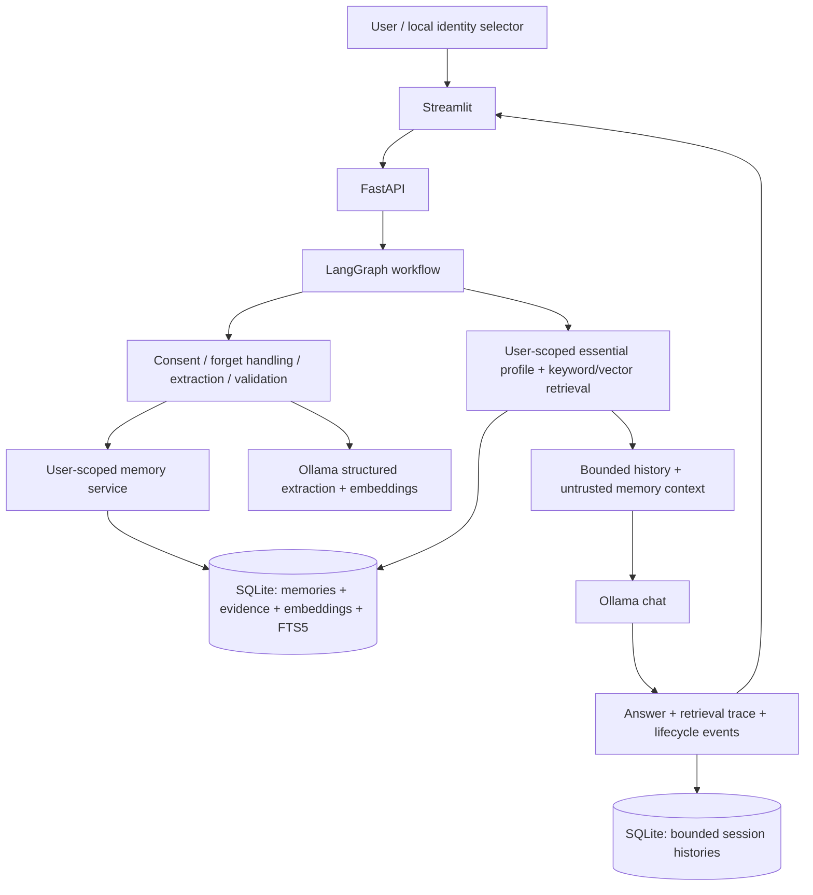

# Architecture

This is a local research MVP for cross-conversation memory, not a production identity system. Design choice made by the implementer: a small explicit memory service is preferable to hiding the experiment inside a second memory framework.

## Selection and alternatives

| Component | Selected | Why / cost |
|---|---|---|
| Runtime | Python 3.12, supported range 3.11–3.13 | Installed Python 3.9 is too old; `uv` can provision the selected version. |
| API / validation | FastAPI, Pydantic 2, pydantic-settings | Typed requests, generated API docs, environment configuration. |
| Agent | LangGraph `StateGraph` | Explicit observable write/read/respond/save stages; no tools or autonomous loops needed. |
| LLM / embedder | Ollama through HTTPX | Local by default, configurable independent chat and embedding models, no key required. |
| Long-term memory | Application-owned SQLite store | Structured upsert, ownership predicates, vector and record deleted in one transaction. This is **not** LangGraph's `BaseStore` implementation. |
| Retrieval | Dense vectors + stdlib cosine + SQLite FTS5/BM25 | Reciprocal rank fusion, thresholded semantic candidates, bounded top k. No separate database or embedding download in tests. |
| Essential profile | Current `response_language` record | Supplied regardless of question similarity, deduplicated against search hits, and kept outside the system role. |
| Session state | Separate SQLite sessions/history | Bounded and restart-safe; avoids checkpoint snapshots retaining deleted memory. |
| UI | Streamlit | Minimal chat and memory CRUD/debugging interface. |
| Verification | pytest, deterministic external-provider fake; opt-in Ollama test | Lifecycle correctness is independent from probabilistic model quality. |

Agno reduces boilerplate but delegates much of the lifecycle to framework flags. Mem0 adds managed extraction/search but requires careful version-specific update behavior. Letta adds a server and agent-managed memory tools. LangGraph plus an explicit local store gives the clearest learning surface. The preferred technology table is a menu, not a requirement to install every library.

Official compatibility references: [LangGraph installation](https://docs.langchain.com/oss/python/langgraph/install), [FastAPI types/Pydantic](https://fastapi.tiangolo.com/python-types/), [Ollama chat schema](https://docs.ollama.com/api/chat), [Ollama embeddings](https://docs.ollama.com/api/embed). Current PyPI metadata was checked during setup; the resolved `uv.lock`, clean sync, and tests are the reproducible compatibility proof. No legacy Agno v1 imports or broad reference-project requirements are copied.

## Modules and models

`api.py` owns HTTP contracts; `agent.py` the graph; `provider.py` external calls; `extraction.py` extraction and forget intent; `memory.py` validation/retrieval; `store.py` transactions and bounded history; `models.py` schemas; `config.py` environment settings. `streamlit_app.py` only calls the API.

A memory contains UUID `id`, `user_id`, canonical `key`, `content`, `memory_type` (`semantic`, `episodic`, `procedural`), optional `source_session_id` and `source_quote`, and UTC creation/update timestamps. A vector column belongs to the memory row; supporting quotes live in an associated evidence table. A unique `(user_id, key)` identifies a mutable fact slot, for example `programming_language_preference`. A normalized content hash prevents identical facts under different keys. A database metadata row records the embedding model identity; changing models requires a new database or explicit re-embedding, not silently mixing vectors.

Sessions use composite `(user_id, session_id)` identity. Histories store only a configurable number of complete user/assistant turns. Graph state lives for one request; there is no durable checkpoint or prompt archive containing forgotten facts.

## Read flow

1. Validate request lengths and local identity; serialize mutations/chat in the single backend process.
2. Handle an explicit forget command before any LLM call. Otherwise extract only when the request opts in.
3. Load that user's essential response-language profile. Embed the question; fuse thresholded cosine ranks with user-filtered keyword ranks, returning at most top k search hits.
4. Build a fixed system instruction, separate untrusted JSON memory context, bounded history, and latest user message.
5. Generate an answer and return `profile_memories`, `retrieved_memories` with cosine/fusion scores, lifecycle events, and warnings. The context deduplicates records by ID. Supplied context does not prove the model reasoned from it.
6. Save the bounded turn. Recognized sensitive input is not retained in history.

## Write flow

Latest user statement → explicit consent → sensitive-data gate → schema extraction → supporting quote validation → vector generation → user-scoped deduplication / key-based upsert with quote and keyword index → atomic SQLite commit. Questions and assistant text are not sources of new facts. Extraction failure skips writes and exposes a warning; a chat-provider failure returns an actionable error. Memory writes happen before response generation, so a failed answer can still leave a committed memory; inspect CRUD before retrying.

The newest assertion for an existing key wins and keeps its ID/creation timestamp. Updates and deletion clear **all that user's history messages**, preventing stale answers and re-exposure of forgotten content. Sessions remain selectable, now empty. This deliberate tradeoff favors predictable memory correctness over retaining every chat turn.

## Boundaries

Run one Uvicorn worker on loopback. A process lock serializes chat/CRUD so one turn cannot restore history another turn just cleared. SQLite transactions protect individual writes; the graph itself is not a distributed transaction. Multiple workers/processes require cross-process coordination before being supported.

`user_id` is an inspectable local namespace, not authentication: anyone with API access can select another ID. Do not expose this service publicly. Production needs authenticated principals, authorization, encryption, retention policies, abuse controls, and tested recovery. Memory text remains untrusted context; it never becomes a system prompt, tool call, or executable procedure. A `procedural` record is descriptive data only.
